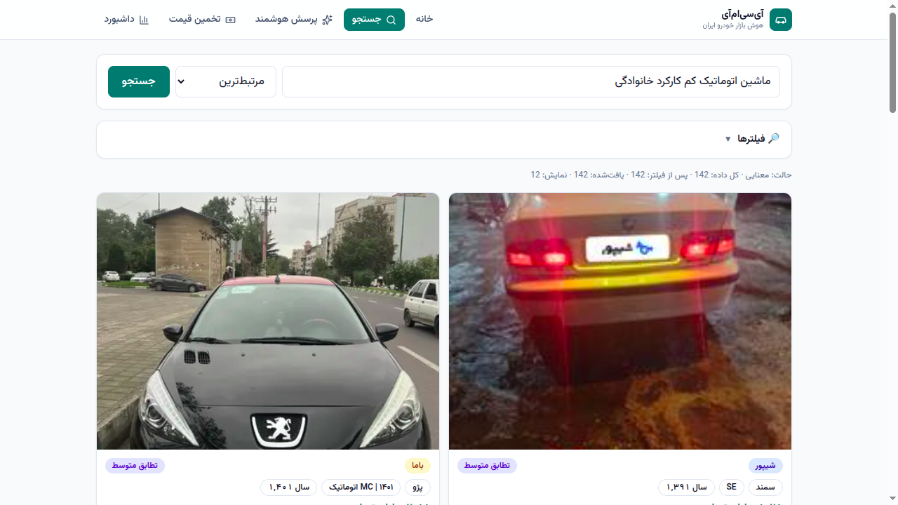
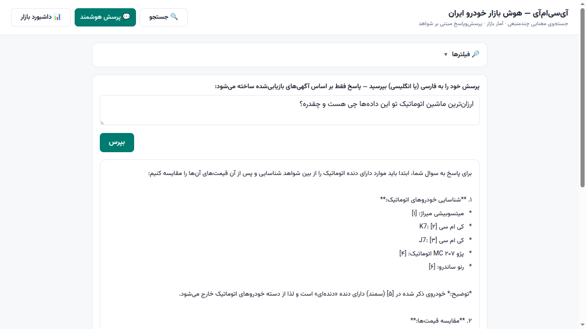
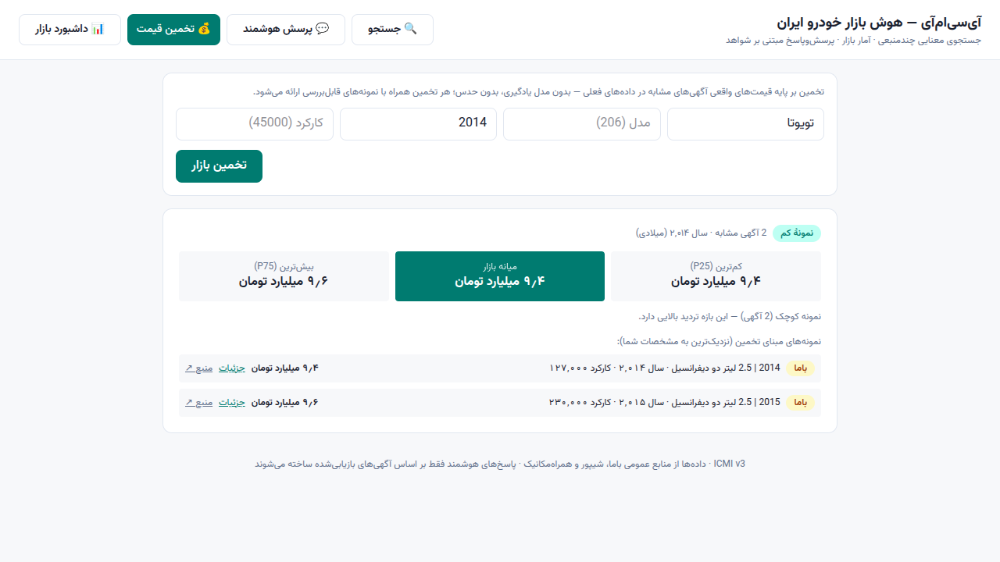

# ICMI — Iranian Car Market Intelligence

Multi-source intelligence platform for the Iranian automotive market, built
on publicly available car-advertisement data. Local-first: everything runs
from this repository with no cloud dependency.

**Two pillars on one data foundation:**

1. **AI Knowledge System** — Persian semantic search over collected ads with
   genuinely-restrictive structured filters, ranked results with original
   excerpts and direct source links, and LLM question answering grounded
   strictly in retrieved evidence.
2. **Market Intelligence** — price history (append-only observations),
   market statistics by brand/model/year with calendar discipline
   (Shamsi vs Gregorian never blended), and retrieval-based price
   estimation from comparable ads (no ML — auditable percentiles of real
   listings).

## Quick start

See [docs/internal/OPERATIONS.md](docs/internal/OPERATIONS.md) for the full
operations guide. In short — two terminals:

```bash
# Terminal 1 — API (search / stats / estimate / ask)
scripts/dev.sh run python scripts/run_api.py          # http://127.0.0.1:8000 (/docs)

# Terminal 2 — web app
cd web && npm install && npm run dev                   # http://localhost:3000
```

Optional: start the LLM proxy (`litellm-start`) for the «پرسش هوشمند» tab —
everything else works without it.

## Screenshots

| جستجو (semantic + filters) | پرسش هوشمند (grounded QA) | تخمین قیمت (comparables) |
|---|---|---|
|  |  |  |

## Architecture

```
collectors (bama, sheypoor, hamrah_mechanic)     config-driven, mode-agnostic
      ↓  raw JSONL + manifests (git carries manifests only)
ETL: re-extract → dedup cross-run → SQLite (listings + append-only price history)
      ↓
analytical Parquet · RAG documents · vector index (e5-small)
      ↓
FastAPI (/search /listings /stats /estimate /ask) ← Next.js (Persian RTL)
```

- **Data layer**: repo-local `data/` (raw → canonical SQLite → analytical
  Parquet → index). The canonical DB is authoritative and rebuilt
  idempotently from raw; `scripts/rebuild_search_assets.py` refreshes every
  derived view.
- **GitHub Actions**: optional/experimental pipeline runner (dispatch-only,
  dormant); artifacts are a temporary transfer channel — import with
  `scripts/sync_latest_data.py` and the local DB ingests them idempotently.
- **Missing-data semantics**: three explicit states (platform-unsupported /
  missing-in-ad / extraction-failed) — nothing is zero-filled or invented.
- **Isolation**: the wrappers keep the package cache, virtualenv, datasets,
  and model caches inside the repository directory.

## Data sources

| Platform | Role | Status |
|---|---|---|
| Bama | Marketplace listings | Collector live-validated |
| Sheypoor | Marketplace listings | Collector live-validated (cursor pagination) |
| Hamrah Mechanic | Dealer exhibition inventory | Collector live-validated |
| Divar | Classifieds | Feasible-unverified: API reachable, proto-JSON contract needs web-client traffic inspection |
| Karnameh | Certified used-car dealer | Deferred (no stable listing identity) |

All endpoints are experimental findings, not guaranteed API contracts; every
collector run produces a manifest with a per-field quality report (see
`manifests/` for the collection history).

## Development

**Always use the repo-local wrappers** — `scripts/dev.sh` (Linux/macOS) or
`.\scripts\dev.ps1` (Windows PowerShell). They guarantee ICMI's full tooling
isolation (`UV_CACHE_DIR` inside the repo, overriding any machine-global
cache; a gitignored `.env` loaded for index overrides and secrets — see
`.env.example`).

```bash
scripts/dev.sh sync              # create .venv, install locked dependencies
scripts/dev.sh run pytest        # 80+ tests, fully offline
scripts/dev.sh run ruff check .
```

```powershell
.\scripts\dev.ps1 sync
.\scripts\dev.ps1 run pytest
```

### Package index

Standard PyPI (`https://pypi.org/simple`) is the default — no network-specific
mirror is imposed by the repository. If pypi.org is unreachable from your
network (e.g. from Iran), copy `.env.example` to `.env` locally and uncomment
the `UV_DEFAULT_INDEX` mirror line. That choice stays on your machine and is
never committed.

Copying the repository directory to another machine (including Windows 10)
is sufficient: `uv sync`, `npm install`, and the data layer travels with the
repo.

## License

MIT — see [LICENSE](LICENSE).
